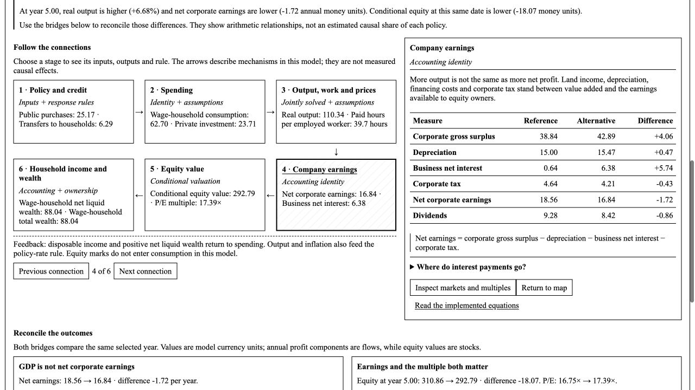

# Mary Mount Economy Lab

**Public source for inspection. All rights reserved. Written permission is required for product use or reuse beyond GitHub's platform permissions.** See [LICENSE](LICENSE). The owner's private font is excluded from this repository; this edition uses Times New Roman.

An economic systems laboratory connecting fiscal and monetary policy, credit, work and leisure, wages, household wealth and ownership to corporate cash flows and conditional security valuations.



[Narrow-screen explanation preview](docs/guided-mobile.jpg)

## What is included

- A question-led walkthrough, clickable mechanism map, exact earnings/value bridges and plain-language definitions.
- A stock-flow accounting core, transaction matrix and explicit balance-sheet counterparts.
- Eleven interpretive economic archetypes and six component controls.
- Seventeen experiments with reference and alternative paths, animation and phase plots.
- Fisher 100% Money and Benes–Kumhof transition illustrations.
- Corporate P/E, P/S and EV multiples, FCFE reconciliation and a macro-sensitive issuer DCF with explicit financing claims.
- An official-source FRED context snapshot, quarterly CSV import, issuer JSON import, saved cases and data exports.
- Primary-source research, equations, a prototype audit, and a verification record.

The model is an original, uncalibrated synthesis. The Fisher/Kumhof dynamic paths use a simplified accommodating Treasury-funding closure and do not replicate the authors' full models. Political bundles are interpretive parameter mappings, not empirical policy estimates.

## Run — owner or authorized users

Python 3.9 or later; standard library only for the application. Node.js 18 or later is needed only for the JavaScript explanation tests. After obtaining any required permission:

```sh
python3 hard_money_forrester_with_knobs.py
```

The launcher opens `http://127.0.0.1:8765/`. Use `--port 8766` if needed. Stop with Ctrl+C. Opening `index.html` directly displays the included saved example; new calculations require the local server. The launcher binds to loopback and is not a production hosting service.

```sh
python3 -m unittest discover -s tests -v
node --test tests/test_explain.cjs
python3 hard_money_forrester_with_knobs.py --case data/example_case.json --csv results.csv
```

## Read

Start the launcher to view these HTML documents in a browser:

- [How to read the lab](ux-guide.html)
- [Research and primary sources](research.html)
- [Implemented equations and model boundaries](methods.html)
- [Seventeen computed experiments](experiments.html)
- [Valuation prototype audit](prototypes.html)
- [Run and reproduce](guide.html)
- [Verification](verification.html)
- [Rights and permissions](permissions.html)

The tests cover accounting, capital formation, ownership, household borrowing, labour choices, reform ledgers, matched valuation ratios, missing claims/FX, terminal conditions, data validation and local HTTP routes. Historical browser replay evidence is distinguished from public-package checks in `verification.json`.

## Data and privacy

The included issuer and case inputs are illustrative. The FRED snapshot is dated, latest-vintage context rather than a point-in-time calibration. Imported issuer inputs require explicit source, currency and date information; missing claims remain unknown.

Private font files, original private notebooks, local working directories, credentials and personal machine paths are excluded. The original local edition is maintained separately. Referenced research and data retain their own rights and terms.

## Permissions

Contact [the repository owner](https://github.com/jupitersstring) for written permission. Public visibility and GitHub's viewing/forking functionality do not grant a general license to deploy, reuse, redistribute or commercialize the product. No private font license is supplied by this repository.
